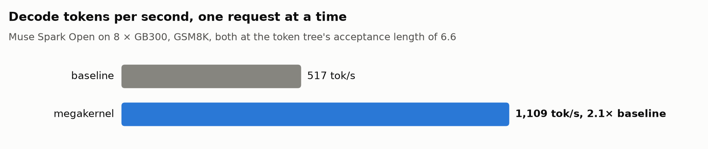
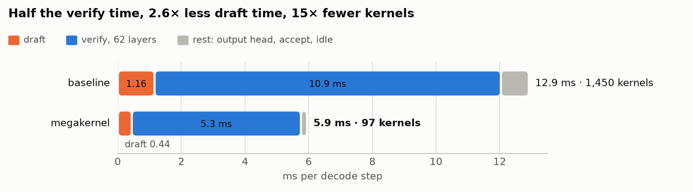
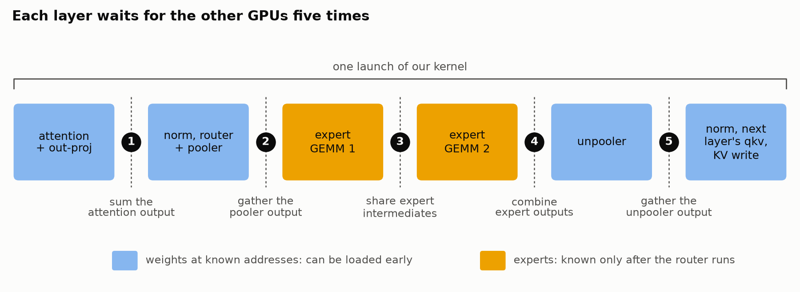

# SGLang Muse Mega

An SGLang plugin that decodes Muse Spark Open on GB300 with **one kernel per decoder layer**. The DFlash2 draft, the
verify and the accept run as one CUDA graph per decode step. Turn it on with `--enable-nvidia-megakernel`.

Up to **1,109 tok/s** on GSM8K on 8 GB300 GPUs (batch 1, greedy, DFlash2 with the token tree): 2.1x SGLang running the
same draft at the same acceptance length.

<picture>
  <source media="(prefers-color-scheme: dark)" srcset="docs/tok_s_dark.png">
  
</picture>

<picture>
  <source media="(prefers-color-scheme: dark)" srcset="docs/step_dark.png">
  
</picture>

*Baseline: SGLang, same draft, same acceptance length. Faster of two runs.*

> **Experimental:** the kernels, the setups they cover and the switch may change.

## How it works

<picture>
  <source media="(prefers-color-scheme: dark)" srcset="docs/layer_dark.png">
  
</picture>

- **One launch per layer:** 144 blocks of 12 warps, attention to the next layer's qkv.
- **Weights load early,** into shared memory or L2, while the op before them runs.
- **Warps specialize:** loaders, tensor cores and math run side by side.
- **No fences between GPUs:** readers poll the data itself.
- **The next layer launches early** (PDL); each launch warms its own code in L2.
- **DFlash2 in one graph;** token tree with `SGLANG_MUSE_MEGA_TREE=1`.

Covers batch-1 decode, greedy or sampled; other requests fall back to SGLang. Details:
[kernel map](sgl_muse_mega/muse_spark/sm103/kernels/README.md).

SGLang's `SGLANG_SIMULATE_ACC_LEN` (with `SGLANG_SIMULATE_ACC_METHOD` and `SGLANG_SIMULATE_ACC_TOKEN_MODE`) forces the
acceptance length of greedy fused steps as it does SGLang's own; sampled requests then run SGLang's step. Not with the
token tree.

## Quick start

Needs an SGLang with the megakernel framework, the CUDA 13.1 toolkit, 8 GB300 GPUs in one NVLink domain (or 4 on one
node), and local copies of `meta-models/Muse-Spark-Open-816B-A42B-NVFP4` and `RadixArk/Muse-Spark-Open-DFlash2`.

```bash
pip install -e .

# TP8, two GB300 nodes (--node-rank 1 on the second), DFlash2 block 16
python -m sglang.launch_server --model-path <Muse-Spark-Open-816B-A42B-NVFP4> --tp-size 8 --ep-size 8 \
  --nnodes 2 --node-rank 0 --dist-init-addr <host>:<port> \
  --quantization modelopt_fp4 --moe-runner-backend flashinfer_trtllm --attention-backend trtllm_mha --page-size 128 \
  --kv-cache-dtype bf16 --context-length 131072 --mem-fraction-static 0.6 --max-running-requests 128 \
  --cuda-graph-max-bs-decode 8 --enable-tf32-matmul \
  --reasoning-parser muse --tool-call-parser muse --sampling-defaults model --enable-metrics \
  --speculative-algorithm DFLASH --speculative-draft-model-path <Muse-Spark-Open-DFlash2> \
  --speculative-draft-attention-backend fa4 --speculative-num-draft-tokens 16 --speculative-use-block-verification \
  --enable-nvidia-megakernel
```

TP4 on one node: `--tp-size 4 --ep-size 4` without the three multi-node flags, `--speculative-num-draft-tokens 8`,
`--mem-fraction-static 0.95 --max-running-requests 8 --cuda-graph-max-bs-prefill 2048`. `--context-length` may reach
SGLang's rope rows: 1048576 on this checkpoint.

The first start builds the kernels (seconds, cached under `$SGLANG_CACHE_DIR/sgl_muse_mega`), and every rank logs
`NVIDIA megakernel: active`. This plugin and sgl-nvidia-mega share SGLang's `nvidia_megakernel` name, so install one.
`python benchmark/bench_gsm8k.py --data test.jsonl` measures GSM8K through the server.

## Layout

```text
sgl_muse_mega/           plugin entry, the nvcc build cache, the Muse Spark specs and SGLang-facing runtime
  muse_spark/sm103/      kernels/ (device code), host/ (cubin load and launches), dflash/ (the draft)
benchmark/               GSM8K through a server
test/                    unit (CPU), kernels (GPU), e2e (a TP4 server)
```

`pytest test` runs on one 4-GPU GB300 node; the e2e test reads `SGL_MUSE_MEGA_MODEL_PATH`, `SGL_MUSE_MEGA_DRAFT_PATH`
and `SGL_MUSE_MEGA_GSM8K`.

## License

MIT. See `LICENSE` and `NOTICE`.
